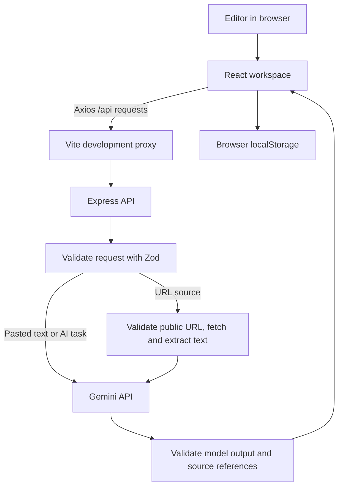

# Editorial AI

Editorial AI is a browser-based workspace for turning source material into an evidence-aware research brief, improving a draft, and shaping research into a newsletter article. The frontend is a React single-page application. The Express backend validates requests and sends AI work to Google's Gemini API.

## Features

- **Overview:** Entry point with shortcuts to the research, writing, and editorial workflows.
- **Research Desk:** Analyze one to twelve article URLs or pasted source texts. The brief includes what happened, why it matters, supporting evidence, source quality, comparisons, contradictions, editorial angles, opportunities for founders and builders, and follow-up questions.
- **Writing Desk:** Review a draft for long sentences, passive voice, filler, unexplained jargon, repetitive wording, and difficult paragraphs. Apply or dismiss suggestions, undo changes, and compare the original and revised draft.
- **Editorial Output:** Generate a 300–500 word newsletter draft from a research brief, with inline source markers and a source-reference list.
- **Local browser storage:** The current research brief and drafts are stored in the user's browser using `localStorage`. There is no database or account system.

## Technology stack

| Area               | Technology                                                                      |
| ------------------ | ------------------------------------------------------------------------------- |
| Frontend           | React 18, React Router, Vite, Axios, Lucide icons, CSS                          |
| Backend            | Node.js, Express 4, native `fetch`                                              |
| AI                 | Gemini `generateContent` API; default model: `gemini-3.5-flash-lite`            |
| Validation         | Zod for request and model-response validation                                   |
| Article extraction | Cheerio for HTML parsing; Node DNS and networking modules for URL safety checks |
| Workspace          | npm workspaces and `concurrently`                                               |
| Code formatting    | Prettier                                                                        |

## Architecture and pipeline



The main request flow is:

1. A user enters article URLs or pastes source text in the Research Desk.
2. URL requests go to the backend. The extractor accepts public HTTP(S), checks DNS results, rechecks redirect destinations, limits response size, and extracts readable page text.
3. Express validates the request. Gemini receives the research instructions and source material; its API key stays on the server.
4. Zod validates Gemini's JSON output. The backend checks source IDs, relevance, required citations, and research-specific quality rules before returning the result.
5. The React app displays the brief and saves it in the current browser. The Writing Desk and Editorial Output use the same API for their respective workflows.

## Repository layout

```text
client/
  src/App.jsx                 React pages and editorial workflows
  src/services/api.js         Axios client for the Express API
  src/styles.css              Application styles
  vite.config.js              Vite server and /api development proxy
server/
  src/config/gemini.js        Gemini client and provider error handling
  src/controllers/            Request handlers and validation entry points
  src/routes/                 Research, writing, and editorial endpoints
  src/services/               Gemini workflows, extraction, and writing rules
  src/utils/                  Prompts and Zod request schemas
  .env.example                Safe local configuration template
README.md                     GitHub-facing setup and API documentation
```

## Requirements

- Node.js 20 or newer
- npm
- A Gemini API key from [Google AI Studio](https://aistudio.google.com/apikey)
- Outbound HTTPS access from the backend to Google's Gemini API

## Run locally

Install dependencies from the repository root:

```bash
npm install
```

Create the server environment file:

```powershell
Copy-Item server/.env.example server/.env
```

On macOS or Linux, use:

```bash
cp server/.env.example server/.env
```

Edit `server/.env` and set `GEMINI_API_KEY`. Keep this file private and do not commit it. The example file sets the default model to `gemini-3.5-flash-lite`; `GEMINI_MODEL` can select another model available to your key.

Start both apps from the repository root:

```bash
npm run dev
```

Then open:

- Frontend: <http://localhost:5173>
- API health: <http://localhost:3001/api/health>

The development frontend proxies `/api` requests to the backend at port 3001. To run each process separately, use two terminals:

```bash
npm run dev:client
```

```bash
npm run dev:server
```

## Configuration

`server/.env.example` documents the supported server settings:

| Variable         | Default                 | Purpose                                                                 |
| ---------------- | ----------------------- | ----------------------------------------------------------------------- |
| `PORT`           | `3001`                  | Express API port                                                        |
| `CLIENT_ORIGIN`  | `http://localhost:5173` | Allowed browser origin; multiple origins can be comma-separated         |
| `GEMINI_API_KEY` | —                       | Gemini credential; required for AI actions                              |
| `GEMINI_MODEL`   | `gemini-3.5-flash-lite` | Gemini model used by research, writing, rewrite, and editorial requests |

The client uses `/api` by default. Set `VITE_API_URL` only when the API is hosted at a different base URL.

## API reference

All successful endpoints return `{ "ok": true, "data": ... }`. Errors return `{ "ok": false, "error": { "code", "message", ... } }`.

| Method | Endpoint                  | Purpose                                            |
| ------ | ------------------------- | -------------------------------------------------- |
| `GET`  | `/api/health`             | Check that the API is running                      |
| `POST` | `/api/research/extract`   | Fetch and extract a public article URL             |
| `POST` | `/api/research/analyze`   | Analyze one or more source texts                   |
| `POST` | `/api/writing/analyze`    | Analyze a draft and return metrics and suggestions |
| `POST` | `/api/writing/rewrite`    | Rewrite one supplied sentence for a stated intent  |
| `POST` | `/api/editorial/generate` | Generate a newsletter draft from a completed brief |

Example extraction request:

```json
{
  "url": "https://example.com/article"
}
```

Example research request:

```json
{
  "question": "What does this development mean for small teams?",
  "sources": [
    {
      "title": "Example article",
      "url": "https://example.com/article",
      "content": "This example passage is a placeholder for the API documentation. Replace it with at least 80 characters copied from a real source before calling the research endpoint.",
      "publishedAt": "2026-01-15"
    }
  ]
}
```

Research accepts one to twelve sources. Every source must contain at least 80 characters of text. A single source can produce a brief, but independent corroboration and cross-source comparison will be reported as unavailable.

Example writing request:

```json
{
  "text": "Paste a draft of up to 40,000 characters here."
}
```

Example sentence-rewrite request:

```json
{
  "sentence": "The sentence to revise.",
  "context": "The paragraph around the sentence.",
  "intent": "Make the sentence more direct."
}
```

The editorial endpoint accepts a completed `brief` and a `sources` array containing each source's `title` and optional `url`. It returns a 300–500 word draft with validated source references.

## Data and safety notes

- The Gemini key is read only by the backend. Never place it in frontend code or commit it to GitHub.
- Article URLs are fetched by the backend. Local and private-network destinations are rejected, redirects are checked, downloads are limited, and extraction requests have a timeout.
- Research source text, writing drafts, and editorial briefs are sent to the Gemini API when the corresponding AI feature is used. Do not submit material you are not authorized to share with that service.
- Research and draft persistence is browser-local. Clearing browser storage removes the locally saved work; there is no server database or account sync.
- There is no authentication or multi-user access control. This repository is a local development project, not a deployed production service.

## Known limitations

- Some publishers block automated fetching, require a browser session, or render article text dynamically. When extraction fails, paste the source text instead.
- Listing pages may contain many unrelated stories. Use individual article URLs for a focused comparison; the research workflow can reject sources that do not cover the same development.
- Gemini availability, quotas, model access, and network connectivity depend on the API key and Google account.
- Generated briefs and drafts should be reviewed against the original sources before publication.

## Development commands

```bash
npm run dev          # Start frontend and backend
npm run dev:client   # Start only the Vite frontend
npm run dev:server   # Start only the Express backend
npm run build        # Build the frontend for production
npm run format       # Format project source and documentation
```

No automated test script is currently configured.
